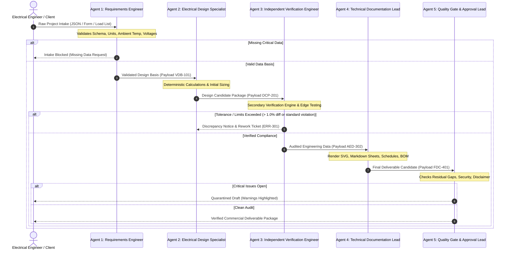

# ProEngineering 5-Agent Specialist Architecture
### Protocol Specification, Data Handshakes, and State Machine
**Framework:** ProEngineering Industrial Power Systems Suite

---

## 1. Architectural Model

The architecture decouples responsibilities so that **no single agent calculates and approves its own work**. Agents interact asynchronously or synchronously by passing strictly typed JSON payloads.



---

## 2. Agent Roles and Specifications

### Agent 1: Requirements & Intake Engineer
- **Core Responsibility:** First-line defensive data audit. Never assumes parameters without tagging them.
- **Inputs:** User input JSON, CSV load list, system frequency (50Hz/60Hz), nominal voltages ($V_{LL}$, $V_{LN}$), earthing type (TN-S, TN-C-S, TT, IT), utility prospective fault level ($I_{sc}$ / MVA).
- **Validation Rules:**
  - Mandatory fields check: Missing conductor material, motor starting method, or ambient temperature halts progression.
  - Plausibility boundaries: Checks for negative power factors, $PF > 1.0$, efficiencies $> 100\%$, or ambient temperatures outside $-20^\circ\text{C}$ to $+65^\circ\text{C}$.
- **Output Handshake Payload (`VDB-101`):**
  ```json
  {
    "projectId": "PRO-2026-IND-01",
    "projectRevision": "0.1",
    "designStage": "PRELIMINARY",
    "governingStandards": {
      "cables": "IEC 60364-5-52:2019",
      "shortCircuit": "IEC 60909-0:2016",
      "switchgear": "IEC 61439-1/2:2020",
      "motors": "IEC 60034-1:2022"
    },
    "gridParameters": {
      "systemFrequencyHz": 50,
      "nominalVoltageV": 415,
      "voltageTolerancePercent": 5.0,
      "prospectiveFaultKa": 50.0,
      "faultDurationSec": 1.0,
      "earthingSystem": "TN-S"
    },
    "environmentalConditions": {
      "ambientAirTempC": 45,
      "groundTempC": 30,
      "altitudeMeters": 250,
      "installationType": "Perforated Cable Tray, Touching"
    },
    "assumptionsRegister": [],
    "status": "VALIDATED"
  }
  ```

---

### Agent 2: Electrical Design Specialist
- **Core Responsibility:** Execute deterministic calculation engine. Apply strict physical equations.
- **Functions:**
  1. Calculate active, reactive, and apparent power:
     $$S = \sqrt{P^2 + Q^2} = \frac{P}{\cos\varphi}$$
  2. Compute design full load current ($I_b$):
     $$I_b = \frac{P}{\sqrt{3} \cdot V_{LL} \cdot \cos\varphi \cdot \eta}$$
  3. Apply thermal derating factors ($k = k_{temp} \cdot k_{group} \cdot k_{soil} \cdot k_{depth}$):
     $$I_z = I_{nominal} \cdot k \ge I_b$$
  4. Compute cable voltage drop:
     $$\Delta V = \sqrt{3} \cdot I_b \cdot L \cdot (R \cos\varphi + X \sin\varphi)$$
     $$\% \Delta V = \frac{\Delta V}{V_{nominal}} \times 100\%$$
- **Output Handshake Payload (`DCP-201`):**
  Contains calculated sizes, currents, candidate cable tags, breaker trip ratings, and computed percentage drops.

---

### Agent 3: Independent Verification Engineer (IV&V)
- **Core Responsibility:** Re-solve using an independent computational pipeline, execute boundary tests, check safety margins.
- **Dual Solver Rule:**
  - Primary solver uses direct impedance formula.
  - Verification solver uses per-unit complex bus admittance or node-voltage formulation.
  - Allowed discrepancy: $|\text{Result}_1 - \text{Result}_2| / \text{Result}_1 < 0.25\%$.
- **Boundary Stress Testing:**
  - Evaluates minimum operating load ($10\%$), rated full load ($100\%$), and motor starting condition ($I_{start} = 6 \times I_{FLC}$ at $\cos\varphi = 0.3$).
  - Verifies that voltage drop during motor starting remains within standard limit (typically $\le 15\%$ at motor terminals).
- **Output Handshake Payload (`AED-302`):**
  Audit findings log, verification variance matrix, and pass/fail certification status.

---

### Agent 4: Technical Documentation Specialist
- **Core Responsibility:** Convert verified numbers into professional client deliverables.
- **Deliverable Engines:**
  1. **SVG Vector Diagram Engine:** Generates standards-compliant electrical symbols (IEC 60617 / IEEE 315) with dynamic bus coordinates, breaker icons, and cable labels.
  2. **Calculation Workbook Engine:** Produces fully detailed Markdown/LaTeX mathematical proofs showing formula, substituted values, intermediate variables, and final result with units.
  3. **Equipment Schedule Engine:** Formats CSV/Markdown tables for switchboard schedules, cable schedules, and load lists.
  4. **Datasheet & BOM Engine:** Produces technical datasheets with candidate commercial ratings.

---

### Agent 5: Quality Gate & Human Approval Lead
- **Core Responsibility:** Enforce commercial safety, compliance disclaimers, and verify that zero critical errors remain.
- **Safety Gate Protocol:**
  ```
  IF (Any Critical Issue == "OPEN") THEN
      Deliverable Status = "QUARANTINED_DRAFT"
      Watermark = "DRAFT - NOT FOR CONSTRUCTION"
      Release Blocked = TRUE
  ELSE IF (Any Major Issue == "OPEN" OR Assumptions > 0) THEN
      Deliverable Status = "PRELIMINARY_DESIGN"
      Watermark = "PRELIMINARY - REQUIRES DETAILED REVIEW"
      Release Blocked = FALSE (With Warnings)
  ELSE
      Deliverable Status = "VERIFIED_DESIGN"
      Watermark = "VERIFIED BY PROENGINEERING DUAL-SOLVER"
      Sign-off Document Generated for Human PE/CEng
  END IF
  ```
