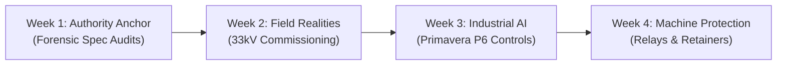

# ProEngineering: 30-Day World-Class Instagram Growth Roadmap

## Overview & Algorithmic Strategy
To build an unmistakable, category-defining B2B brand and achieve maximum viral reach in heavy industrial engineering, the content strategy balances two primary algorithmic signals:
1. **Saves (Bookmarks)**: Driven by dense technical infographics, single-line diagrams, and reference checklists.
2. **Shares (Team Group Chats)**: Driven by painful, relatable field mistakes, cost overruns, and forensic contract teardowns.

---

## 4-Week Strategic Sprint Architecture

---

## Day-by-Day Viral Master Calendar (Days 1 to 30)

| Day | Pillar | Format | Viral Hook & Script Concept | Audio / Visual Cue | Keyword CTA & Lead Magnet |
|---|---|---|---|---|---|
| **01** | Forensic Teardown | 45s Reel | "How one missed line in Division 26 triggers a \$400K switchgear change order..." | Red warning flash on 300-page spec text | Comment `SPEC` for Pre-Bid Checklist |
| **02** | Field Reality | 7-Slide Carousel | "5 SLD vs. Site Mistakes That Delay 33kV Substation Commissioning" | High-contrast dark-mode schematics | Comment `SLD` for Sign-Off Matrix |
| **03** | Project Controls AI | 30s Reel | "Watch Agentic AI audit a Primavera P6 schedule and expose float traps in 20s" | Screen recording of P6 Gantt with AI overlay | Comment `P6` for Schedule Playbook |
| **04** | Pattern-Interrupt | 2-Char Reel | "⚠ 33kV Energization Alert: Why breakers trip on Day-1 soak after passing FAT" | Red alert siren vs. Cyan waveform dialogue | Comment `RELAY` for Zero-Trip SOP |
| **05** | Visual Breakdown | Infographic Carousel | "Generator Protection Relays (MiCOM P343) Explained on One Page" | 4:5 ANSI 87G, 40, 46, 64R visual matrix | Comment `GEN` for Wiring Schematic |
| **06** | Engineering Debate | Talking-Head Reel | "Why GIS (Gas Insulated Switchgear) is not always superior to AIS for 33kV" | Side-by-side CAPEX vs OPEX breakdown | Comment `GIS` for Cost Comparison Sheet |
| **07** | Weekly Case Study | Carousel | "RCA of a \$1.2M Transformer Fire: The Single Point CT Grounding Trap" | Forensic fire scene photo + CT circuit vector | Comment `RCA` for Full Investigation Report |
| **08** | Forensic Teardown | 45s Reel | "The \$500K Cable Sizing Trap: Why Soil Thermal Resistivity Kills EPC Margins" | Thermal camera view of overheating trench | Comment `CABLE` for Ampacity Derating Tool |
| **09** | Field Reality | 5-Slide Carousel | "4 Secondary Injection Traps with OMICRON CMC 356 Sets" | OMICRON ramp curve & timing graph | Comment `OMICRON` for Testing Template |
| **10** | Industrial AI | 30s Reel | "How We Built an Agentic AI Bot that Reviews 500 Substation As-Builts in 3 Mins" | Fast terminal logs & automated markup | Comment `AGENT` for AI Workflow Architecture |
| **11** | Pattern-Interrupt | 15s Reel | "POV: The client's inspector asks for transformer tan delta results at 5:00 PM on Friday" | Funny relatable site manager meme hook | Comment `TEST` for Transformer Test Log |
| **12** | Visual Breakdown | Infographic Carousel | "ANSI Relay Number Cheat Sheet (50/51, 87T, 67, 59N, 81U/O)" | Dark-mode single-sheet reference card | Comment `ANSI` for High-Res Print File |
| **13** | Forensic Teardown | 45s Reel | "The Hidden 3-Second Fault Withstand Clause in Utility PPA Contracts" | 31.5kA vs 40kA mechanical forces comparison | Comment `FAULT` for Calculation Sheet |
| **14** | Project Controls AI | Carousel | "7 Red Flags in an EPC Master Schedule That Guarantee 3-Month Delays" | Gantt bars with fake progress indicators | Comment `AUDIT` for P6 Health Audit Guide |
| **15** | Mid-Month Masterclass | 60s Reel | "23 Years of Megaproject Lessons Condensed into 60 Seconds" | Fast-paced montage of substation builds | Comment `PRO` for 23-Year Engineering Rules |
| **16** | Field Reality | 7-Slide Carousel | "VCB Timing Analysis: Closing, Opening, and Contact Bounce Limits" | Millisecond timing graphs & micro-ohm meter | Comment `VCB` for Switchgear Acceptance Form |
| **17** | Industrial AI | 30s Reel | "AI-Powered SLD Takeoff: Generating Cable Feeder Schedules from CAD in Real-Time" | CAD drawing turning into automated BOM | Comment `BOM` for Cable Schedule Generator |
| **18** | Pattern-Interrupt | 2-Char Reel | "When the Commissioning Lead tells the Project Director energization is delayed 3 weeks" | Split screen tension & resolution | Comment `SOAK` for Soak Checklist |
| **19** | Visual Breakdown | Carousel | "How Differential Protection (ANSI 87T) Actually Works Inside a Numerical Relay" | Dual-slope restraint curve diagram | Comment `CURVE` for Relay Setting Formula |
| **20** | Forensic Teardown | 45s Reel | "Why 80% of Compact Substations (CSS) Overheat in High Ambient Sites" | CFD thermal airflow model vs field enclosure | Comment `CSS` for Ventilation Sizing Math |
| **21** | Field Reality | Carousel | "Battery Bank & DC Charger Commissioning: Float, Boost, and Discharge Sizing" | 110V/220V battery room inspection tips | Comment `BATTERY` for DC Sizing Calculator |
| **22** | Project Controls AI | 30s Reel | "Predicting Liquidated Damages (LD) Risks 60 Days Before Site Mobilization via AI" | AI predictive risk dashboard | Comment `RISK` for LD Prevention Framework |
| **23** | Pattern-Interrupt | 15s Reel | "Things EPC Contractors Say vs. What the As-Built Drawing Actually Shows" | Contrasting site reality clips | Comment `ASBUILT` for Drawing Review Checklist |
| **24** | Visual Breakdown | Infographic Carousel | "Earth Pit Testing: Wenner 4-Pin Method vs Clamp-On Fall of Potential" | Soil resistivity test setup diagrams | Comment `EARTH` for Grounding Design Guide |
| **25** | Forensic Teardown | 45s Reel | "How One Missing Interlocking Key on an RMU Created a Total Plant Blackout" | Cast-key mechanical interlocking diagram | Comment `RMU` for Interlock Safety Matrix |
| **26** | Field Reality | 6-Slide Carousel | "Dissolved Gas Analysis (DGA) Interpretation: Duval Triangle Explained" | Duval triangle acetylene & methane zones | Comment `DGA` for Oil Analysis Diagnostic Chart |
| **27** | Industrial AI | 30s Reel | "Automating Relay Coordination Studies: From ETAP Models to Relay Scripts via AI" | Automated ETAP to CSV relay parameter script | Comment `ETAP` for AI Automation Guide |
| **28** | Pattern-Interrupt | 2-Char Reel | "Site Manager vs. Protection Engineer: 'Can't we just bypass the 87T relay for 1 hour?'" | Humorous but high-stakes dialogue | Comment `BYPASS` for Safety Protocol Rules |
| **29** | Visual Breakdown | Carousel | "Lightning Arrester (Surge Arrester) Sizing: MCOV, Discharge Class & TOV" | Voltage-current surge suppression curve | Comment `SURGE` for Arrester Selection Sheet |
| **30** | The Retainer Funnel | 60s Reel | "Building Multi-Million Dollar Substations Without Single-Point Failures: The ProEngineering Blueprint" | Recap of all 30 days & client case results | Comment `PARTNER` for Advisory Consultation |

---

## The 3-Step Comment-to-Client Funnel Execution

1. **Step 1: Spike the 60-Minute Velocity**:
   - The one-word keyword trigger in every post prompts high comment volume within the first hour of publication.
   - Instagram's algorithm interprets this velocity as viral interest and pushes the content to non-followers across the Explore page and Reels tabs.

2. **Step 2: Instant Technical Delivery (DM Automation)**:
   - Commenters automatically receive the requested PDF checklist, calculation sheet, or vector schematic.
   - Immediate value establishes unquestioned technical authority in 30 seconds.

3. **Step 3: Advisory Diagnostic Retainer Bridge**:
   - Every asset includes a clear callout inviting Project Directors, Plant Managers, and EPC Leads to book a 30-minute Pre-Bid Spec Audit or Substation RCA Advisory session at `proengineering.in`.

